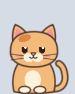

<div align="center">
  
  <h1>DrowsyDock</h1>
  <p>A macOS menu-bar app with a cat that sits on your Dock and gets drowsier as the battery drains.<br>
  Below 50% it gets drowsy, and below 10% it falls asleep. Plug in the charger and it wakes up.</p>
  <p>
    <a href="https://github.com/nickatnight/drowsydock/actions/workflows/ci.yml"></a>
    <a href="LICENSE"></a>
    <a href="#requirements"></a>
  </p>
  <p></p>
</div>

**Status:** The cat, Dock tracking and the overlay work. Settings come next, then signed and notarized releases. Until then you build it yourself, and builds are ad-hoc signed.

## Requirements

- macOS 14 or later
- Xcode with Swift 6. The checks pass on Xcode 27.2 (Swift 6.4.2), the version CI uses.
- gitleaks, for `scripts/check.sh` only (CI uses 8.30.1)

## Quick start

```sh
scripts/bundle.sh             # builds build/DrowsyDock.app, universal, ad-hoc signed
open build/DrowsyDock.app
```

DrowsyDock has no Dock icon. It lives in the menu bar as a moon with "zzz". The cat appears once the app has Accessibility access, below.

To quit, choose Quit DrowsyDock (⌘Q) from the menu, or run `pkill -x DrowsyDock`.

## Accessibility access

DrowsyDock reads the Dock's position and size through Accessibility, to put the cat on it. Without the grant it draws nothing, and the menu still shows the battery line.

1. Choose **Grant Accessibility…** from the menu. macOS shows its alert and opens System Settings ▸ Privacy & Security ▸ Accessibility with DrowsyDock in the list.
2. Turn DrowsyDock on, then open the menu again. You don't need to relaunch: the item reads **Accessibility: Granted** and the cat appears within a second.

Turning it off hides the cat again.

`scripts/bundle.sh` signs ad hoc, so each rebuild is a new app to macOS and needs a new grant. If the old DrowsyDock entry shows as on but the menu still says Grant Accessibility…, remove the entry with − and grant again.

## How it behaves

While the Mac runs on battery, the cat follows the percentage:

| Battery | Cat |
|---|---|
| 50% and above | Awake |
| 30 to 49% | Drowsy |
| 20 to 29% | Yawning |
| 10 to 19% | Nodding off |
| Below 10% | Asleep, and a veil dims the Dock |

- During one discharge the cat only gets sleepier. If the percentage goes back up, it stays as sleepy as it was.
- Plug in the charger and it wakes up with a stretch and a sparkle, then stays awake at any percentage while the Mac is on power. Unplug and it takes the state of the current percentage.
- The first time the cat falls asleep in a discharge, the whole Dock nods off: a wave runs along the Dock, and each icon dims for 0.3 s and puffs a "z". The wave takes at most 4 s. It plays once per discharge and can play again after the charger has been plugged in. It doesn't play when the app starts below 10%.
- On a bottom Dock the cat sits on the last icon. On a left or right Dock it sits at the top end, facing into the screen. It hides while an auto-hidden Dock is off screen, and fades out while the Dock magnifies or the pointer is on the icon under it, so you can read that icon's label. Clicks go through it to the Dock.
- On a Mac without a battery there is no cat, and the menu says No battery detected.

## The menu

- The battery line, for example `63% · Discharging · Drowsy`, with `· Low Power` added while Low Power Mode is on.
- **Grant Accessibility…**, or **Accessibility: Granted** once it is.
- **Debug ▸ Simulate battery**: Real, 80%, 40%, 25%, 15%, 5%, Charging or No battery, to see every state without draining the battery.
- **Debug ▸ Log Dock geometry**: writes the Dock's frames and the cat's perch to the log.
- **Quit DrowsyDock** (⌘Q).

## Your data

DrowsyDock keeps no settings and writes no files in normal use. macOS keeps the Accessibility grant.

- It logs to the unified log under the subsystem `com.drowsydock.DrowsyDock`: the battery line when it changes, the Accessibility grant, the Dock's frames, when the overlay shows or hides, when the wave plays, and errors. Reading it with `log stream` needs an administrator account.
- Launched with `--qa-log`, it also appends every log line to `~/Library/Logs/DrowsyDock/qa.log`. Only your account can read the file, and it starts over rather than grow past 1 MiB. Delete it whenever you like.

## Development

| Command | Runs |
|---|---|
| `swift build -Xswiftc -warnings-as-errors` | The build, with warnings as errors |
| `swift test` | Every test |
| `swift test --enable-code-coverage` | The tests, with coverage |
| `RECORD_SNAPSHOTS=1 swift test` | Rewrites the snapshot references, then fails on purpose |
| `swift format lint --strict --recursive Sources scripts/qa/Sources Tests` | The format lint. `swift format --in-place --recursive Sources scripts/qa/Sources Tests` fixes most findings. |
| `scripts/bundle.sh` | `build/DrowsyDock.app`, universal, signed with `$SIGN_IDENTITY` (default `-`, ad hoc) and the hardened runtime |
| `scripts/check.sh fast` | Compile, format lint, the live QA script's checks, the floor rules from CONSTRAINTS.md, the QA row mapping, the README's links and banner, and the secret scan. Run it after every edit. |
| `scripts/check.sh task` | `fast`, then the tests with coverage, the changed-line coverage gate against `$CHECK_BASE` (default `main`) and the signed bundle. Run it before every commit. |
| `scripts/readme/banner.sh` | Rebuilds `docs/readme/` (this page's banner and cat) from the snapshot references |

To follow the log without an administrator account:

```sh
open build/DrowsyDock.app --args --qa-log && tail -F ~/Library/Logs/DrowsyDock/qa.log
```

The snapshot tests compare the cat against PNG references in `Tests/DrowsyDockTests/Snapshots/`. The references were recorded on Apple silicon, so the snapshot tests skip on Intel Macs, and `DROWSYDOCK_SKIP_SNAPSHOTS=1` skips them anywhere. A mismatch writes the actual image and a diff under `.build/snapshot-failures/`.

`scripts/qa-live.sh` checks the rows of `docs/manual-qa.md` that need the real app and the real Dock. It changes the Dock's preferences through System Events and restores them from `build/qa/dock-backup.plist` when it exits. Run it on your own Mac only. `--dry-run` prints every step and changes nothing, and `--restore` puts back the preferences of a run that was killed.

[CI](.github/workflows/ci.yml) runs `scripts/check.sh task` on every pull request to `main` and every push to `main`, on the `xcode-27` runner with Xcode 27.2 and gitleaks 8.30.1. It skips the snapshot tests (`DROWSYDOCK_SKIP_SNAPSHOTS=1`) and gates coverage against `origin/main`. When a run fails, it uploads `.build/snapshot-failures/`.

## Docs

- [CONSTRAINTS.md](CONSTRAINTS.md): the quality bar and what each check enforces
- [CLAUDE.md](CLAUDE.md): the layout, the commands and the engineering conventions
- [docs/manual-qa.md](docs/manual-qa.md): every QA row, the test or live scenario that covers it, and the manual checklist
